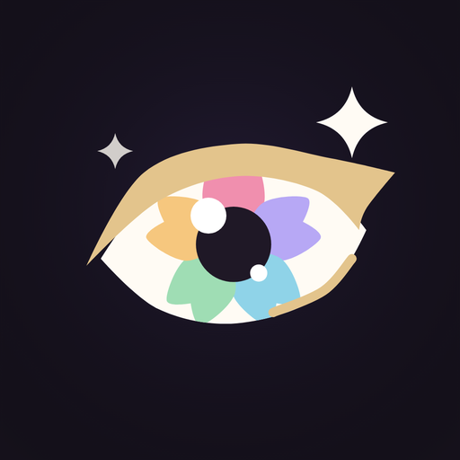
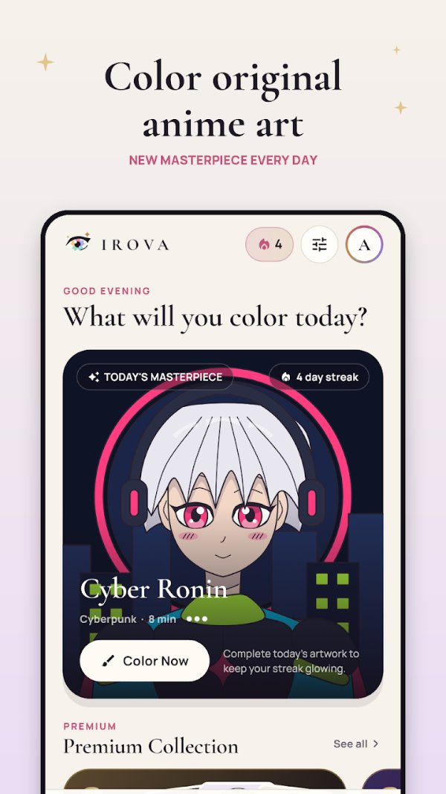
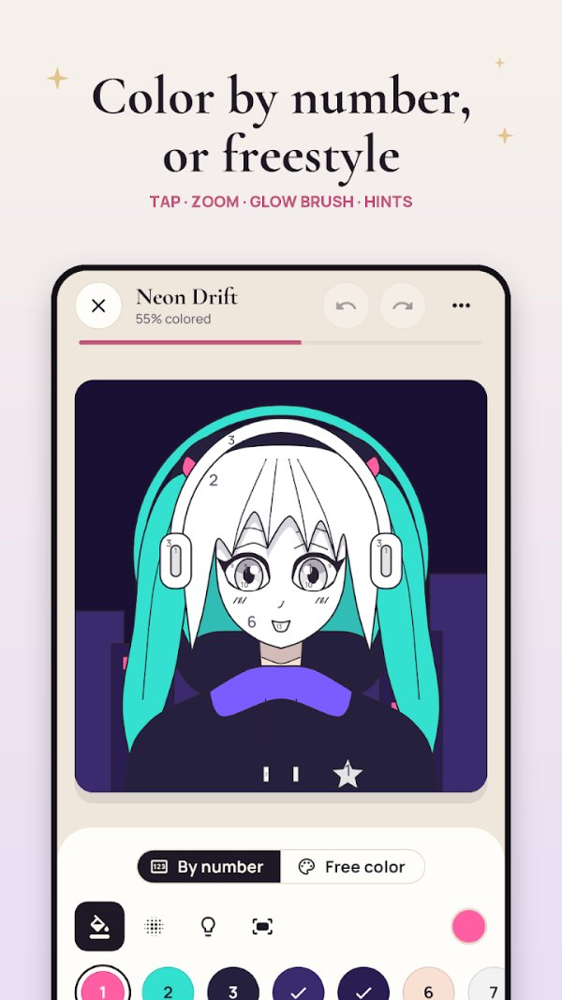
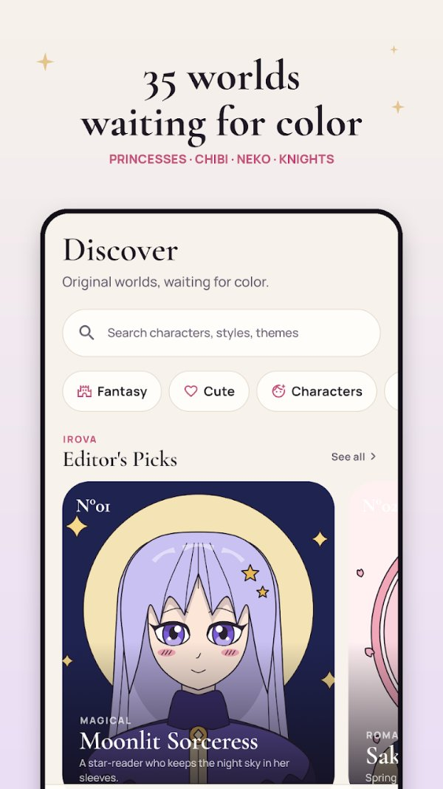
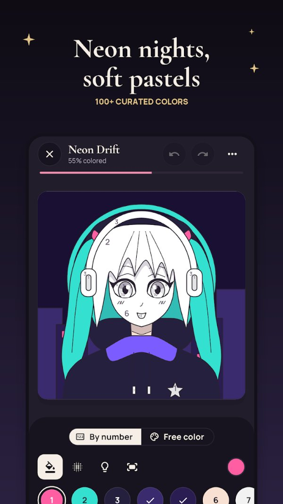

  

<h1 align="center">IROVA: Anime Color by Number</h1>

  A relaxing anime coloring game with <b>original</b> chibi, kawaii and fantasy art, built with Flutter. 
  

  
  
  
  
  

---

## 📸 Screenshots

  
  
  
  

## ✨ Features

- 🎨 **Color by number** or **free color** mode
- 🖌️ Pinch-to-zoom, undo/redo, hints and a glow brush for soft anime shading
- 🖼️ 35 original artworks across 10 worlds (Fantasy, Chibi, Cyberpunk, Romance and more)
- 📅 **Today's Canvas**: a new featured artwork every day
- 🌈 100+ curated colors, custom color mixing and saved favorites
- ⏱️ Time-lapse replay of every finished piece
- 🔥 Daily streaks, achievements, light and dark themes
- 📴 Works fully offline. No ads, no tracking, art stays on the phone
- 💎 Premium packs (Royal, Mythic, Neon) as one-time purchases

## 🛠️ Built with

| Area | Tech |
|---|---|
| App | Flutter, Dart |
| Platform | Android 7.0+ |
| Monetisation | Google Play in-app purchases (one-time) |
| Privacy | Offline-first, no ads SDK, no tracking |

## 📦 Status

Live on Google Play: **v1.0.0**, released October 2026.

> The source code of this commercial app is private. This repository is a public showcase.

---

  Built by <a href="https://github.com/techwest-ali">Ali Asad</a> · <b>Techwest Solutions Limited</b> 
  Need a Flutter app like this? <a href="https://www.linkedin.com/in/ali-asad-980866305/">Message me on LinkedIn</a>

